# Flujos de potencia IEEE-118 en MATLAB — caso base y escenario 1

MI-5215 · II semestre 2026. Escenario elegido: salida de la línea 26–30 de 345 kV.

**Integrantes: PENDIENTE completar nombres reales.** Este informe y sus Excel constituyen evidencia computacional, no un video grabado. La grabación MP4, las voces de todos los integrantes y la entrega institucional siguen pendientes; véase `CUMPLIMIENTO_GUIA_VIDEO.md`.

## 1. Resumen

El proyecto implementa un flujo de potencia AC mediante Newton-Raphson, Gauss-Seidel y desacoplado rápido, sin utilizar MATPOWER como motor de cálculo. Los datos se importan de Excel, se validan y se convierten en un modelo nodal común. A partir de él se obtienen tensiones complejas, inyecciones, generación calculada por barra, flujos en ambos extremos de las ramas y balances de potencia. La consola exporta resultados y la interfaz gráfica permite editar entradas, resolver el caso base y luego retirar la línea 26–30, conservar la referencia, comparar y exportar ambos estados.

La evidencia disponible comprende IEEE-14, IEEE-118 e IEEE-300, con 14, 118 y 300 barras. Las nueve combinaciones de caso y método convergieron con tolerancia de desbalance de `1e-8 pu` y límites reactivos desactivados. El caso principal IEEE-118 presenta pérdidas activas de ramas de **132.862872 MW**; Gauss-Seidel requiere **757 iteraciones**. Estos valores incorporan la corrección de las consignas de generación `VG`, que no deben confundirse con las magnitudes iniciales `VM`.

La prioridad del estudio y del video es **IEEE-118 y el escenario 1: salida de la línea 26–30**. La contingencia eleva las pérdidas de 132.862872 a 165.897686 MW (+33.034814 MW, +24.864 %), aumenta de 3 a 6 las barras fuera de 0.95–1.05 pu y sitúa la mínima en 0.940040 pu (barra 21). NR/GS/FDLF convergen en 4/909/11 iteraciones. La sección 9 reúne el unifilar publicado, las tablas obligatorias y las tres respuestas. IEEE-14 es prueba breve de versatilidad; IEEE-300 queda como respaldo opcional fuera del video.

La validación independiente con MATPOWER 8.1 aprobó las nueve comparaciones de tensiones y flujos. Además, IEEE-118 se cotejó con el caso oficial distribuido por esa versión. El acuerdo respalda las ecuaciones y convenciones empleadas en estas condiciones, pero no demuestra cumplimiento de límites operativos, robustez ante contingencias ni validez para una red regional real. Los tiempos documentados son observaciones de ejecución, no un experimento estadístico controlado. El informe distingue expresamente entre modelo eléctrico, procedimiento numérico, verificación interna y validación externa.

## 2. Introducción, objetivos y alcance

### 2.1. Problema técnico

El flujo de potencia determina el estado estacionario de una red a partir de demandas, generación especificada, consignas de tensión y parámetros eléctricos. Su dificultad reside en que las potencias dependen no linealmente de las tensiones. Conocer únicamente la demanda total y la generación total no permite deducir el reparto de flujos, las necesidades reactivas o las pérdidas: también importan la topología, las impedancias y los controles de tensión.

Implementar varios métodos sobre un mismo modelo permite separar dos preguntas. La primera es física: qué estado satisface las ecuaciones AC para los datos suministrados. La segunda es numérica: mediante qué actualizaciones y cuántas iteraciones se alcanza ese estado. Dos métodos pueden producir curvas de convergencia muy distintas y, sin embargo, representar la misma solución final. A la inversa, tres métodos pueden coincidir entre sí y compartir un error de interpretación de datos.

### 2.2. Objetivos

El objetivo general es disponer de una solución MATLAB trazable para calcular y comparar flujos de potencia de tamaño variable. Los objetivos específicos son:

1. Importar libros Excel sin fijar a 118 el número de barras ni exigir identificadores consecutivos.
2. Construir Ybus con ramas, transformadores, desfases y derivaciones nodales.
3. Implementar los tres métodos con una definición común del desbalance y de las consignas reguladas.
4. Documentar diferencias reales de coste y actualización, evitando atribuir al código optimizaciones inexistentes.
5. Exportar evidencia verificable por barra, rama e iteración.
6. Contrastar los resultados con un solucionador independiente y conservar criterios explícitos de aceptación.

### 2.3. Frontera del estudio

El modelo corresponde a régimen permanente sinusoidal, representación nodal monofásica equivalente y cargas de potencia constante. No calcula desequilibrios entre fases, transitorios electromecánicos, frecuencia, protección, cortocircuitos ni despacho económico. Tampoco resuelve un flujo óptimo de potencia: los límites de generación y de tensión presentes en las tablas no se convierten automáticamente en restricciones de optimización.

Los tres casos incluidos son sistemas de prueba. Su resolución no constituye una validación de una instalación actual ni un estudio de seguridad operativa. Se estudió una contingencia concreta N-1: la salida de la línea 26–30 (escenario 1 de la guía del video). No se realizaron campañas de sensibilidad de carga, barridos de relajación, un barrido exhaustivo N-1 ni pruebas estadísticas de rendimiento. Esas actividades se consideran posibles extensiones, no resultados de este trabajo.

## 3. Casos, procedencia y significado de las entradas

### 3.1. Inventario

Los libros `data/IEEE14.xlsx`, `data/IEEE118.xlsx` y `data/IEEE300.xlsx` contienen respectivamente 20, 186 y 411 registros de ramas, y 5, 54 y 69 registros de generadores. Los tres utilizan base de 100 MVA. Las cantidades son registros de entrada: un generador no equivale necesariamente a una barra regulada, pues puede haber varias unidades en una barra, unidades inactivas o generación conectada a una barra PQ.

<!-- BEGIN:inventario -->

| Caso | Barras | Ramas | Registros gen. | Base MVA |
| --- | ---: | ---: | ---: | ---: |
| IEEE-14 | 14 | 20 | 5 | 100 |
| IEEE-118 | 118 | 186 | 54 | 100 |
| IEEE-300 | 300 | 411 | 69 | 100 |

<!-- END:inventario -->

El caso principal IEEE-118 procede del sistema de prueba archivado por la Universidad de Washington [5], una aproximación de parte del sistema American Electric Power de diciembre de 1962. No representa sin más una red moderna. Las advertencias de esa fuente sobre límites MVA impiden tratarlos como capacidades históricas verificadas.

La validación de procedencia más fuerte se realizó para IEEE-118: su entrada se comparó con `data/case118.m` de MATPOWER 8.1. Coincidieron base MVA, trece columnas de barras, diez columnas de generadores empleadas por el flujo y trece columnas de ramas; los errores máximos registrados fueron cero. La comparación considera equivalentes los taps cero y uno cuando ambos significan relación unitaria.

Para IEEE-14 e IEEE-300, MATPOWER recibió exactamente los datos importados de los respectivos Excel. Esto valida la solución sobre esas entradas, pero no acredita identidad de todos sus campos con cualquier variante publicada de los casos homónimos. El nombre del caso no sustituye una comparación de datos.

### 3.2. Tipos de barra y estados efectivos

Una barra PQ fija las inyecciones activa y reactiva y deja libres magnitud y ángulo. Una PV fija potencia activa y magnitud; su reactiva se obtiene de la solución. La única Slack fija magnitud y ángulo y absorbe el balance activo y reactivo restante. El código exige exactamente una Slack y al menos un generador activo en ella.

<!-- BEGIN:tipos_barras -->

| Caso | Slack (BUS_I) | PV efectivas | PQ efectivas | Incógnitas |
| --- | ---: | ---: | ---: | ---: |
| IEEE-14 | 1 | 4 | 9 | 22 |
| IEEE-118 | 69 | 53 | 64 | 181 |
| IEEE-300 | 7049 | 68 | 231 | 530 |

<!-- END:tipos_barras -->

`bus_sets.m` no interpreta ciegamente la columna `TYPE`: una PV sin generadores activos se resuelve como PQ. En cambio, una Slack sin generación activa se rechaza. `STATUS` distinto de cero significa servicio; una unidad inactiva no aporta `PG` ni `QG`, no regula tensión y no genera conflictos de consigna. Los identificadores se relacionan mediante un mapa, no por coincidencia entre número de barra y posición matricial.

## 4. Modelo AC, unidades y construcción de Ybus

### 4.1. Sistema por unidad y signos

La potencia base es común a toda la red. Las potencias de entrada se expresan en MW y MVAr, mientras que resistencias, reactancias y susceptancias de ramas están en pu. Las magnitudes de tensión son pu y los ángulos de los libros están en grados; las operaciones trigonométricas internas utilizan radianes. Si se parte de impedancias físicas, su conversión requiere bases de tensión coherentes, aunque esa conversión no forma parte del lector.

```math
S_("pu") = frac(S, S_("base")), quad Z_("base") = frac(U_("base")^2, S_("base"))
```

La convención nodal es generación menos demanda. `specified_power.m` inicia los vectores con demanda negativa y suma las unidades activas asociadas a cada barra. En particular, varias unidades activas suman sus potencias.

```math
P_i^("spec") = frac(P_(G i) - P_(D i), S_("base"))
```

```math
Q_i^("spec") = frac(Q_(G i) - Q_(D i), S_("base"))
```

Estas expresiones no significan que ambas potencias se impongan en todos los tipos de barra. La activa Slack y la reactiva de PV y Slack quedan fuera del vector de ecuaciones exigidas. Por ello, un valor de `QG` de entrada en una PV no determina su reactiva final cuando los límites están desactivados.

### 4.2. Rama equivalente y transformación compleja

Cada rama activa se modela mediante admitancia serie, carga capacitiva repartida entre extremos y un transformador ideal en el extremo `F_BUS`. Se define el tap complejo a partir de su magnitud y del desfase. El código interpreta como unitario un tap cuya magnitud es prácticamente cero.

```math
y = frac(1, r + j x), quad t = tau exp(j phi)
```

```math
Y_(f f) = frac(y + j b/2, t overline(t)), quad Y_(f t) = -frac(y, overline(t))
```

```math
Y_(t f) = -frac(y, t), quad Y_(t t) = y + j b/2
```

Aquí `b` es `BR_B`, no una demanda de barra. Las cuatro contribuciones se acumulan en las posiciones correspondientes de Ybus. Las ramas paralelas se suman naturalmente y las fuera de servicio no aportan admitancia. Un desfase puede hacer diferentes los términos cruzados; por ello no debe imponerse simetría sin examinar el modelo.

Las derivaciones de barras se añaden a la diagonal:

```math
Y_(i i)^("sh") = frac("GS"_i + j "BS"_i, S_("base"))
```

`GS` y `BS` representan MW y MVAr a tensión de 1 pu. Una conductancia positiva consume potencia activa; una susceptancia positiva representa aporte capacitivo con la convención utilizada. Se incorporan en Ybus, no como sumandos adicionales de `PD` o `QD`.

`build_ybus.m` utiliza una matriz compleja densa de dimensión igual al número de barras. La construcción por acumulación es transparente para inspección, aunque no aprovecha la dispersión física de una red de transmisión. La validación rechaza reactancias prácticamente nulas incluso si una rama está fuera de servicio; no implementa una reducción especial para enlaces ideales.

### 4.3. Ecuaciones nodales

Sea V el vector complejo y U su magnitud. La corriente y la potencia inyectadas se calculan con el modelo completo:

```math
I_i = sum_(k=1)^n Y_(i k) V_k, quad S_i = V_i overline(I_i)
```

```math
V_i = U_i exp(j theta_i), quad Y_(i k) = G_(i k) + j B_(i k)
```

Definiendo la diferencia angular entre barras, las ecuaciones polares son:

```math
theta_(i k) = theta_i - theta_k
```

```math
P_i^("calc") = U_i sum_(k=1)^n U_k (G_(i k) cos(theta_(i k)) + B_(i k) sin(theta_(i k)))
```

```math
Q_i^("calc") = U_i sum_(k=1)^n U_k (G_(i k) sin(theta_(i k)) - B_(i k) cos(theta_(i k)))
```

Estas potencias están en pu cuando Ybus y V están en pu. `calculate_power.m` permite obtenerlas en unidades físicas multiplicando por la base. La forma compleja reduce duplicación de fórmulas en el cálculo del residual.

### 4.4. Variables y criterio de parada

El conjunto A contiene todas las barras excepto la Slack; el conjunto PQ es el efectivo, incluida una PV sin regulación activa. Las incógnitas son los ángulos de A y las magnitudes de PQ. Con una Slack, el número de ecuaciones es el número de barras menos uno, más el número de barras PQ efectivas.

```math
Delta P_i = P_i^("spec") - P_i^("calc"), quad Delta Q_i = Q_i^("spec") - Q_i^("calc")
```

```math
Delta S = mat(Delta P_A; Delta Q_("PQ")), quad e = norm(Delta S)_infinity
```

Se declara convergencia cuando e no supera la tolerancia. El máximo desbalance es un error de potencia, no de tensión. Sobre base de 100 MVA, `1e-8 pu` equivale a `1e-6 MW` o `1e-6 MVAr` para la componente correspondiente; no es una garantía universal de error angular o de magnitud.

### 4.5. Inicialización: diferencia entre VM y VG

`initial_voltage.m` conserva `VA` como ángulo inicial y toma `VM` como magnitud inicial en PQ. En PV y Slack con unidades activas, `voltage_setpoints.m` sustituye esa magnitud por `gen.VG`. La tensión regulada no es un valor inicial libre: permanece impuesta durante la resolución. En una PQ, incluso si tiene generación, `VG` no impone regulación.

Si falta completamente la columna `VG`, se utiliza `VM` de la barra asociada como respaldo. La asociación se hace por identificador después de ordenar las barras. No se sustituye una `VG` explícita inválida por 1 pu: consignas no reales, no positivas o no finitas se rechazan. También se rechazan tensiones iniciales PQ inválidas. Un `VM` inválido en una barra regulada puede ser irrelevante si una `VG` válida lo reemplaza.

Cuando varias unidades activas regulan una misma barra, sus consignas deben coincidir dentro de una tolerancia relativa de `1e-10`, con escala mínima de 1 pu. Se utiliza la primera consigna compatible, no un promedio. Esta regla evita pedir simultáneamente magnitudes incompatibles a una única variable nodal.

## 5. Desarrollo de los métodos numéricos

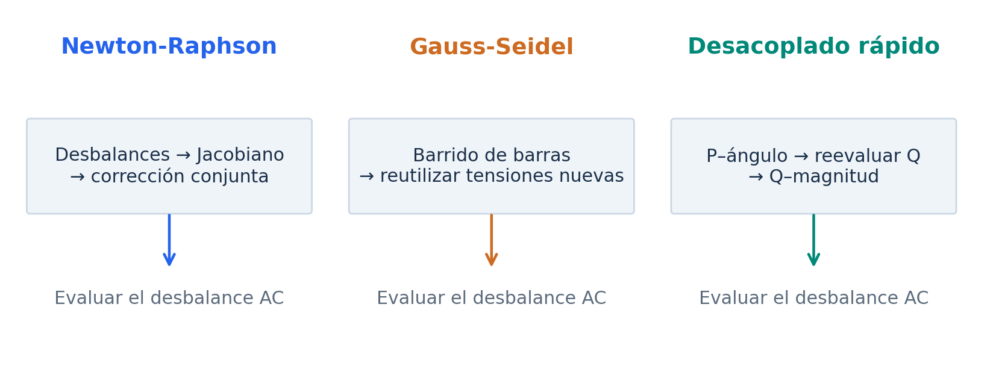

### 5.1. Newton-Raphson completo

La implementación de `solve_newton_raphson.m` parte de la misma tensión inicial que los otros métodos y evalúa el residual antes de iterar. Si ya cumple la tolerancia, informa cero iteraciones. De lo contrario construye en cada paso el Jacobiano completo respecto a las variables libres.

```math
J = mat(H, N; M, L)
```

```math
J mat(Delta theta_A; Delta U_("PQ")) = mat(Delta P_A; Delta Q_("PQ"))
```

Los bloques H, N, M y L corresponden respectivamente a derivadas de P respecto a ángulo, P respecto a magnitud, Q respecto a ángulo y Q respecto a magnitud. Se utiliza el Jacobiano de las potencias calculadas, con el residual especificado menos calculado; por eso la corrección se suma al estado.

Para posiciones distintas de la diagonal, el código implementa:

```math
H_(i k) = U_i U_k (G_(i k) sin(theta_(i k)) - B_(i k) cos(theta_(i k)))
```

```math
N_(i k) = U_i (G_(i k) cos(theta_(i k)) + B_(i k) sin(theta_(i k)))
```

```math
M_(i k) = -U_i U_k (G_(i k) cos(theta_(i k)) + B_(i k) sin(theta_(i k)))
```

```math
L_(i k) = U_i (G_(i k) sin(theta_(i k)) - B_(i k) cos(theta_(i k)))
```

Los términos diagonales utilizan las potencias ya calculadas:

```math
H_(i i) = -Q_i^("calc") - B_(i i) U_i^2
```

```math
N_(i i) = frac(P_i^("calc"), U_i) + G_(i i) U_i
```

```math
M_(i i) = P_i^("calc") - G_(i i) U_i^2
```

```math
L_(i i) = frac(Q_i^("calc"), U_i) - B_(i i) U_i
```

Solo se ensamblan las filas y columnas necesarias según los conjuntos de barras. El sistema lineal se resuelve con el operador de división izquierda de MATLAB; no se forma una inversa explícita. A continuación se actualizan ángulos no Slack y magnitudes PQ, se reconstruye V y se comprueba el nuevo desbalance. Las magnitudes PV y el estado Slack permanecen fijados.

La corrección se aplica completa: no hay búsqueda lineal, amortiguamiento adaptativo ni región de confianza. El código detiene la ejecución si aparece una magnitud no positiva o un residual no finito, y dispone de manejo de excepciones para el sistema lineal. No toda advertencia de mal condicionamiento de MATLAB equivale a una excepción; estos controles no reemplazan un diagnóstico completo del Jacobiano.

El fundamento se relaciona con el método de Newton aplicado al flujo de potencia [2]. Su rapidez local puede explicar las pocas iteraciones observadas, pero depende de la inicialización y de la regularidad del problema. Construir y resolver un Jacobiano denso tiene un coste por iteración mayor que una simple actualización escalar; comparar métodos solo por iteraciones oculta esa diferencia.

### 5.2. Gauss-Seidel con relajación y barras PV

`solve_gauss_seidel.m` recorre secuencialmente las barras no Slack. El cálculo de cada candidata usa los valores disponibles en ese instante: las barras ya visitadas contienen su tensión actualizada y las restantes conservan la de la pasada anterior. En notación de una actualización local:

```math
V_i^("cand") = frac(frac(P_i^("spec") - j Q_i^("use"), overline(V_i)) - sum_(k != i) Y_(i k) V_k, Y_(i i))
```

```math
V_i^("rel") = V_i + alpha (V_i^("cand") - V_i)
```

Para PQ, la reactiva utilizada es la especificada. Para PV, antes de actualizar la barra se calcula la potencia compleja con las tensiones disponibles y se toma su componente reactiva. Después de relajar, se proyecta el resultado sobre la magnitud regulada:

```math
V_i^("new") = U_i^("set") exp(j arg(V_i^("rel")))
```

La relajación predeterminada es 1.5. El solucionador admite valores mayores que cero y hasta dos; la GUI ofrece un intervalo más estrecho. Un factor mayor que uno extrapola la corrección y puede acelerar algunas redes, pero también perjudicar otras. No se efectuó un barrido para demostrar que 1.5 sea óptimo.

Una iteración registrada equivale a una pasada completa por todas las barras no Slack, seguida de una evaluación del residual. La Slack no se actualiza y la reactiva PV no se impone como ecuación de convergencia. Esto permite comparar el desbalance final con los otros métodos sin exigir en PV un valor de `QG` que físicamente debe resultar del control de tensión.

Existe una particularidad de coste importante: dentro del bucle de cada PV el código calcula `S = V .* conj(Ybus*V)` para toda la red, aunque solo necesita la reactiva de esa barra. Como Ybus es densa, cada una de esas reevaluaciones implica un producto matriz-vector de coste cuadrático en el número de barras. Una pasada suma, además, productos de filas para las actualizaciones locales. Por tanto, esta implementación no debe describirse como una pasada de coste mínimo basada exclusivamente en vecinos; el número de PV y la reevaluación global influyen en su tiempo.

La simplicidad conceptual de Gauss-Seidel no implica que esta versión sea siempre la más barata. En las redes mayores se combina ese trabajo repetido con centenares o miles de pasadas. Optimizar la evaluación de la reactiva local sería una mejora concreta, pero requeriría conservar exactamente el uso secuencial del estado y comprobar de nuevo las regresiones.

### 5.3. Desacoplado rápido: matrices realmente implementadas

El desacoplado rápido aproxima las sensibilidades dominantes entre activa y ángulo, y entre reactiva y magnitud. Su motivación es especialmente razonable en redes de transmisión con acoplamientos cruzados relativamente débiles [3]. No elimina la no linealidad del residual AC: simplifica las matrices utilizadas para obtener las correcciones.

`fast_decoupled_matrices.m` forma dos matrices reales constantes para cada resolución. Ambas ignoran resistencia serie, derivaciones nodales, carga capacitiva de las ramas y desplazamiento de fase. La primera incluye la magnitud del tap; la segunda no. Para una rama con reactancia x y tap tau, sus contribuciones son:

```math
B'_("rama") = frac(1, x) mat(frac(1, tau^2), -frac(1, tau); -frac(1, tau), 1)
```

```math
B''_("rama") = frac(1, x) mat(1, -1; -1, 1)
```

Se acumulan esas contribuciones para las ramas activas, se reduce B prima al conjunto de ángulos no Slack y B doble prima a PQ. La distinción de taps es propia de la implementación inspeccionada. No se identifica aquí como una variante exactamente XB o BX, pues esa etiqueta exigiría contrastar todas las convenciones de construcción.

Cada iteración comienza calculando la activa con Ybus completa. Se divide su desbalance componente a componente por la magnitud actual y se corrigen los ángulos:

```math
B' Delta theta_A = frac(Delta P_A, U_A)
```

Con los ángulos nuevos se recalcula la reactiva, se normaliza y se corrigen las magnitudes PQ:

```math
B'' Delta U_("PQ") = frac(Delta Q_("PQ"), U_("PQ"))
```

Las divisiones de estas dos ecuaciones son elemento a elemento. Una iteración contabiliza ambas etapas, no una sola corrección. Al terminar se evalúa el mismo residual AC completo que en Newton-Raphson y Gauss-Seidel. Por ello, ignorar shunts o resistencias en las matrices aproximadas no significa ignorarlos en la solución final.

Las matrices se construyen fuera del bucle, pero el código ejecuta una división izquierda en cada etapa de cada iteración. No almacena una factorización LU ni un objeto de descomposición para reutilización explícita. En consecuencia, no se atribuye al proyecto una reutilización de factores que no está programada. Los controles de magnitudes no positivas, residual no finito y excepciones de resolución son análogos a los de Newton-Raphson.

### 5.4. Máximo de iteraciones y límites reactivos

`recommended_max_iterations.m` conserva el máximo solicitado para casos de hasta 118 barras. Para tamaños mayores establece como mínimo el mayor entre 5000 y cien veces el número de barras. IEEE-300 recibe así **30000 iteraciones**, aunque solo Gauss-Seidel necesita superar las 1000 en los resultados disponibles. La política se aplica a los tres métodos mediante `solve_power_flow`, no únicamente desde `main`. No modifica la tolerancia; `recommended_tolerance.m` mantiene el valor solicitado.

Si `enforceQLimits` está activo y una resolución converge, `apply_q_limits.m` calcula la generación reactiva requerida por cada PV, sumando inyección calculada y demanda. Compara ese valor con la suma de `QMIN` y `QMAX` de sus unidades activas. Una violación convierte la barra a PQ y fija su reactiva al límite agregado; el objetivo se asigna a la primera unidad activa y las demás reciben cero en esa representación interna.

El wrapper vuelve entonces a resolver el caso modificado. No utiliza la tensión anterior como arranque de continuación: el solucionador reconstruye su inicialización desde el caso de trabajo. La conversión es un tratamiento agregado por barra, no un reparto óptimo entre unidades; no actúa sobre la Slack ni restaura automáticamente una PQ a PV. **Los nueve resultados de los casos de prueba y los tres del escenario 1 tienen esta opción desactivada** y no prueban el comportamiento operativo del mecanismo bajo límites.

## 6. Arquitectura, Excel e interfaz gráfica

### 6.1. Separación de responsabilidades

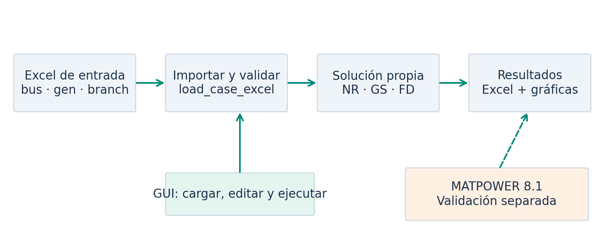

La entrada se procesa en `load_case_excel.m`; `validate_case.m` comprueba referencias y estructura, mientras que `voltage_setpoints.m` centraliza la regulación. `build_ybus.m`, `specified_power.m` y `power_mismatch.m` proporcionan el núcleo compartido. `solve_power_flow.m` selecciona el método, administra opciones y conversiones Q, y llama a `assemble_result.m`. Este último reconstruye potencias y tablas a partir del estado complejo, usando `calculate_branch_flows.m` para las ramas.

Esta organización evita mantener tres interpretaciones diferentes de Excel. Sin embargo, compartir funciones también implica compartir sus posibles defectos: el acuerdo interno no detecta necesariamente un error común de modelado. La validación externa complementa precisamente esa debilidad.

### 6.2. Contrato de los libros

Se requieren hojas equivalentes a `bus`, `gen` y `branch`; se aceptan alias como `barras`, `generadores` y `ramas`. Las columnas mínimas son `BUS_I`, `TYPE`, `PD`, `QD`; `GEN_BUS`, `PG`, `QG`; y `F_BUS`, `T_BUS`, `BR_R`, `BR_X`. El lector normaliza nombres, convierte columnas numéricas, completa columnas omitidas y ordena las barras por identificador.

La hoja opcional `config` proporciona la base MVA; en su ausencia se utiliza 100. Entre los valores de respaldo figuran `VM=1`, `VA=0`, `GS=BS=0`, estados en servicio, `BR_B=0`, `TAP=1` y `SHIFT=0`. Los límites Q omitidos quedan no acotados. Estos respaldos se aplican a columnas ausentes, no como reparación general de cualquier celda defectuosa.

`VMIN`, `VMAX`, `PMIN`, `PMAX`, límites de ángulo y capacidades de ramas pueden conservarse en las tablas sin intervenir como restricciones del flujo. Es importante distinguir información importada de controles efectivamente aplicados. Los dos libros IEEE-118 actualizados incluyen las tres tablas de entrada, `config` con `baseMVA` y `parametros` con las opciones de cálculo y el alcance del tiempo. Los libros auxiliares antiguos pueden no incluir estas dos hojas; siempre debe conservarse el Excel original.

### 6.3. Salidas y GUI

El estudio principal utiliza **cinco archivos Excel**: dos entradas (`data/IEEE118.xlsx` y `data/IEEE118_escenario1.xlsx`), dos resultados (base y escenario) y un comparativo (`comparacion_escenario1.xlsx`). Los tres métodos se guardan en hojas dentro de cada resultado, no en libros independientes por método. Los Excel IEEE-14/300 y de validación son auxiliares.

`main.m` ejecuta los métodos en orden Newton-Raphson, Gauss-Seidel y desacoplado rápido, exporta el libro y opcionalmente genera gráficas. El nombre predeterminado de entrada es IEEE-118 y el de salida se deriva del caso. Así se evita que un cálculo de 300 barras quede identificado como IEEE-118.

`app_flows.m` utiliza los mismos solucionadores. Permite cargar Excel, editar tablas, elegir métodos, tolerancia, máximo, relajación y límites Q. Presenta comparación, historial de desbalance, magnitudes y ángulos. Seleccionar un archivo lo carga; el botón de carga permite repetir la operación.

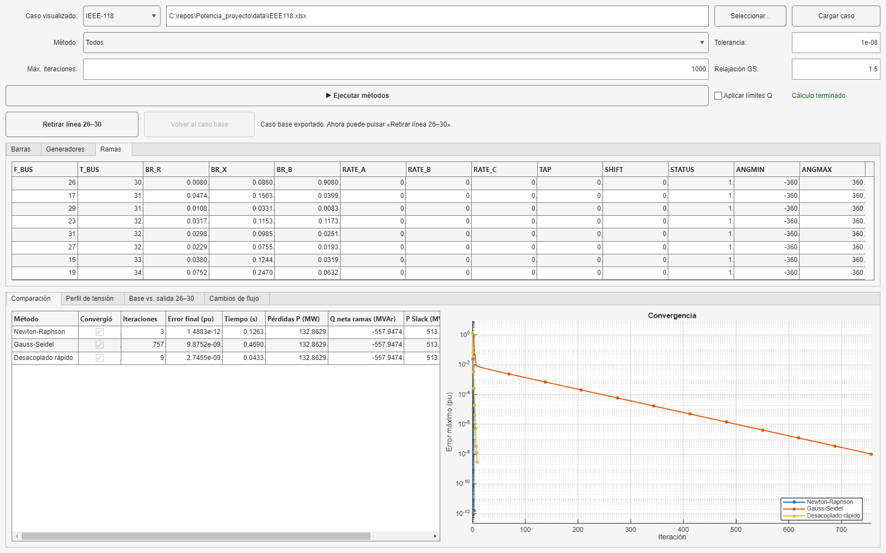

Las ediciones son en memoria y no se guardan automáticamente en el Excel de entrada. Para el escenario 1, la GUI exporta el IEEE-118 base tras resolver los tres métodos y habilita **Retirar línea 26–30** únicamente con datos originales, tolerancia ≤1e-8, límites Q desactivados y convergencia de los tres métodos. Al pulsar, verifica la copia modificada, usa los mismos parámetros, conserva el snapshot base y exporta base, escenario y comparación. Las pestañas **Base vs. salida 26–30** y **Cambios de flujo** muestran la tabla, perfiles y rankings; la rama retirada se resalta en las entradas. **Volver al caso base** restaura red y resultados guardados sin recalcular. Para otros cálculos la exportación sigue disponible por consola.

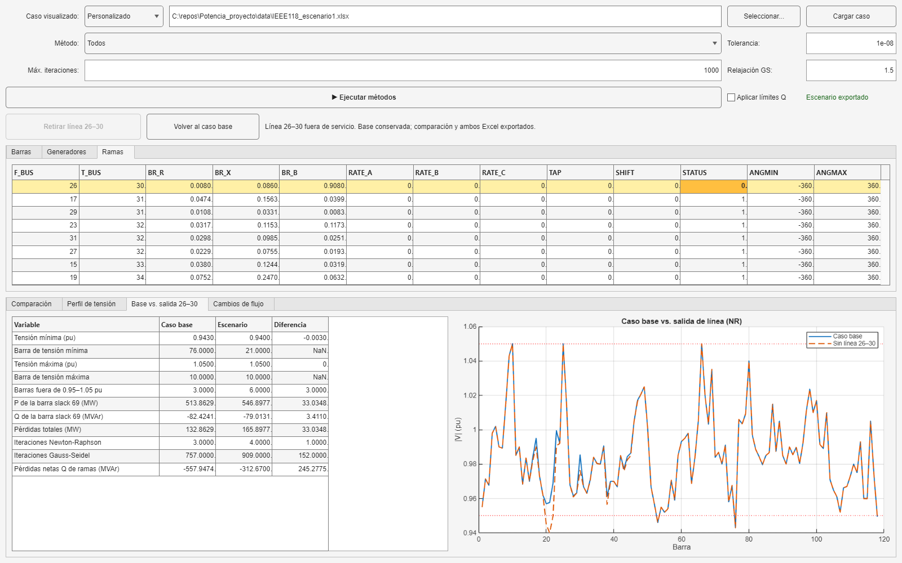

Una edición de datos, método, opciones o archivo invalida el snapshot y la comparación; los controles se bloquean durante el cálculo y el botón vuelve a comprobar la vigencia del caso base antes de intervenir. Las pruebas de GUI usan `app_flows(carpetaTemporal)` para no reemplazar la evidencia numérica incluida; sin argumento las salidas se guardan en la raíz. El estado visual de cálculo terminado no reemplaza revisar la convergencia. Una recarga puede sustituir datos editados y se deben conservar por separado las entradas de estudios adicionales.

## 7. Metodología y reproducibilidad

### 7.1. Condiciones de cálculo

Los resultados documentados se obtuvieron con MATLAB R2025a Update 1, usando las condiciones iniciales de los libros y las consignas `VG` activas. No se presupuso un arranque plano. La tolerancia fue `1e-8 pu`, la relajación GS 1.5 y los límites Q permanecieron desactivados. El máximo fue 1000 para IEEE-14 e IEEE-118 y 30000 para IEEE-300.

<!-- BEGIN:parametros -->

| Parámetro | Solución propia | Referencia |
| --- | --- | --- |
| Método | NR, GS y FD | NR de MATPOWER |
| Tolerancia de potencia | 1e-8 pu | 1e-10 pu |
| Máximo IEEE-14 / IEEE-118 | 1000 | 30 |
| Máximo IEEE-300 | 30000 | 30 |
| Relajación GS | 1.5 | No aplica |
| Aplicar límites Q | No | No |
| Inicialización | VM/VA y VG activa | Datos equivalentes |
| MATPOWER | No requerido por main | 8.1 |

<!-- END:parametros -->

El procedimiento separa importación, resolución, posprocesamiento y exportación. Para aceptar una solución se comprueban convergencia declarada, residual recalculado finito, respeto de consignas y correspondencia de dimensiones. Después se contrastan tensiones y flujos entre métodos y con MATPOWER. La ausencia de diferencias visibles en una gráfica no sustituye los máximos errores tabulados.

### 7.2. Interpretación de los tiempos

`solve_power_flow.m` inicia su cronómetro después de la validación y selección del método. El intervalo medido incluye el solucionador, la construcción de resultados y, si se solicitan, los ciclos de límites Q. En las nuevas corridas IEEE-118 con `verbose=true`, también incluye la impresión del mismatch por iteración; no es tiempo puro del álgebra. No incluye lectura inicial de Excel, exportación ni gráficas. El ensamblaje vuelve a construir Ybus y a calcular flujos; por tanto, `elapsedSeconds` no mide exclusivamente el núcleo iterativo.

El libro de IEEE-118 fue actualizado mediante una ejecución posterior a las registradas para los otros casos; las tablas toman los valores actualmente almacenados en cada archivo. Por tanto, los tres libros no representan un único protocolo de medición simultáneo y controlado. No hay repeticiones controladas, intervalos de confianza ni normalización de calentamiento, carga del equipo u orden de ejecución. Comparar esas observaciones sirve para describir esta ejecución, no para publicar un benchmark ni extrapolar un factor universal de aceleración.

### 7.3. Trazabilidad y precauciones de repetición

La evidencia debe mantener unidos caso de entrada, opciones, versión y resultados. La identidad se verifica por `BUS_I` y extremos de rama, no solo por nombre de archivo. Un resultado antiguo con consignas distintas no debe mezclarse con una entrada corregida.

La exportación principal escribe primero un libro temporal y reemplaza el destino al completar la escritura. Debe cerrarse en Excel y utilizarse otro destino si se necesita conservar una corrida. Las pruebas emplean directorios temporales; la validación externa utiliza también escritura temporal y posterior reemplazo. Los comandos del apéndice describen una reproducción deliberada, no acciones automáticas sobre una sesión gráfica abierta.

## 8. Resultados: prioridad IEEE-118 y pruebas complementarias

El video se centra en IEEE-118 y el escenario 1 (sección 9). IEEE-14 se utiliza solo para demostrar versatilidad, idealmente en menos de un minuto. IEEE-300 se conserva como respaldo técnico opcional: no se le asigna tiempo en la exposición.

### 8.1. IEEE-118: caso principal corregido

La solución corregida presenta **132.862872 MW** de pérdidas activas de ramas. Newton-Raphson necesita tres iteraciones, Gauss-Seidel **757** y el desacoplado rápido nueve. La diferencia respecto a resultados anteriores no proviene de aflojar la tolerancia: se corrigió la interpretación de la magnitud regulada.

En las barras 19, 32, 34, 92 y 103 difieren `bus.VM` y `gen.VG`. Fijar la primera como consigna alteraba el problema eléctrico y producía pérdidas cercanas a 132.4778 MW. Esos resultados quedan sustituidos. La corrección también cambia el recuento GS anterior de 760 a 757, de acuerdo con la evidencia de validación.

<!-- BEGIN:resultados_118 -->

| Método | Iter. | Error final (pu) | P ramas (MW) | Tiempo (s) |
| --- | ---: | ---: | ---: | ---: |
| Newton-Raphson | 3 | `1.4883e-12` | 132.862872 | 0.512477 |
| Gauss-Seidel | 757 | `9.8752e-09` | 132.862872 | 0.593610 |
| Desacoplado rápido | 9 | `2.7455e-09` | 132.862872 | 0.128876 |

<!-- END:resultados_118 -->

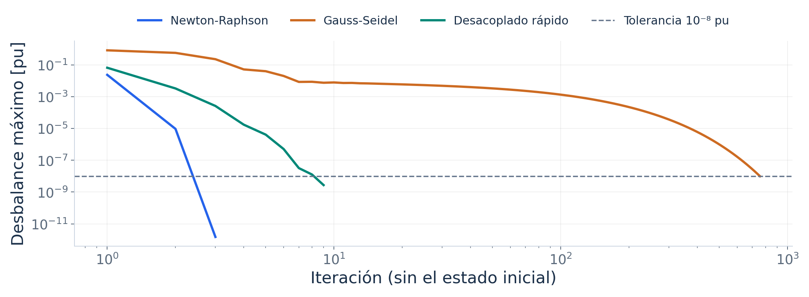

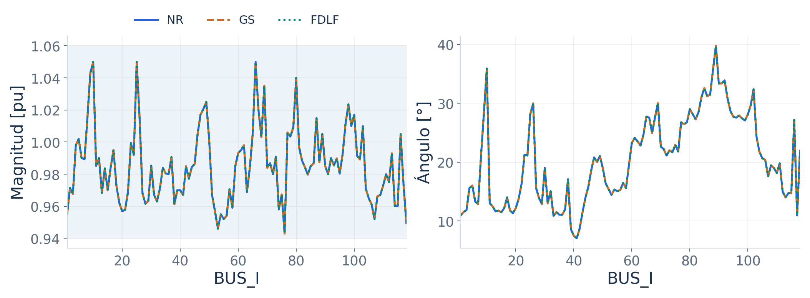

La magnitud mínima de referencia es 0.943 pu y la máxima 1.05 pu. La casi superposición de perfiles entre métodos muestra que las diferencias de procedimiento numérico no implican diferencias eléctricas significativas bajo la tolerancia utilizada.

### 8.2. IEEE-14 — demostración breve de versatilidad

Las tres soluciones convergen. Newton-Raphson requiere dos correcciones, Gauss-Seidel 37 pasadas y el desacoplado rápido 13 iteraciones dobles. Las pérdidas activas de ramas son aproximadamente 13.393272 MW. El pequeño número de pasos de Newton es compatible con una entrada inicial próxima al estado resuelto; no demuestra convergencia desde cualquier estado.

<!-- BEGIN:resultados_14 -->

| Método | Iter. | Error final (pu) | P ramas (MW) | Tiempo (s) |
| --- | ---: | ---: | ---: | ---: |
| Newton-Raphson | 2 | `1.3158e-10` | 13.393272 | 0.230350 |
| Gauss-Seidel | 37 | `8.2925e-09` | 13.393272 | 0.044553 |
| Desacoplado rápido | 13 | `8.1546e-09` | 13.393272 | 0.043830 |

<!-- END:resultados_14 -->

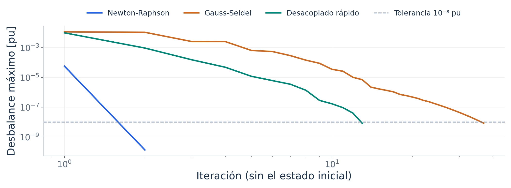

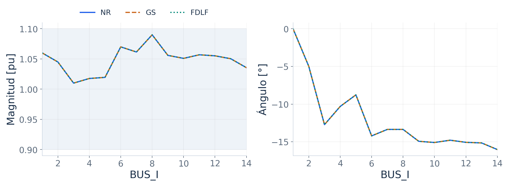

Las gráficas representan el máximo desbalance desde la primera iteración y omiten el estado inicial cero para utilizar escala logarítmica horizontal. El historial exportado a Excel sí conserva ese estado inicial. El perfil de magnitud de la referencia NR se encuentra entre 1.01 y 1.09 pu. Ello describe el caso suministrado, pero no convierte todos esos valores en recomendaciones operativas.

### 8.3. IEEE-300 — complemento opcional fuera del video

Newton-Raphson converge en dos iteraciones, Gauss-Seidel en 2693 y el desacoplado rápido en 25. Las pérdidas activas de ramas son aproximadamente **408.98554 MW**. Un tope de 1000 habría detenido prematuramente GS en estas condiciones; elevarlo a 30000 permite completar el proceso sin cambiar el criterio de precisión.

<!-- BEGIN:resultados_300 -->

| Método | Iter. | Error final (pu) | P ramas (MW) | Tiempo (s) |
| --- | ---: | ---: | ---: | ---: |
| Newton-Raphson | 2 | `7.8079e-12` | 408.985541 | 0.111765 |
| Gauss-Seidel | 2693 | `9.9893e-09` | 408.985540 | 7.443946 |
| Desacoplado rápido | 25 | `6.6290e-09` | 408.985541 | 0.123619 |

<!-- END:resultados_300 -->

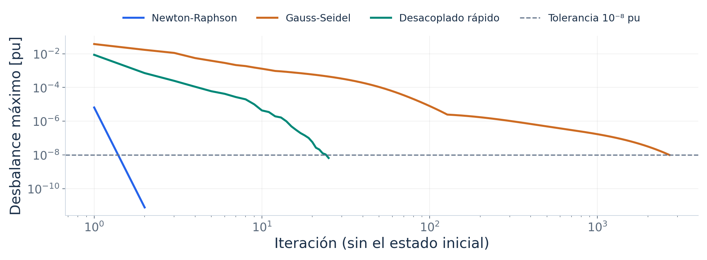

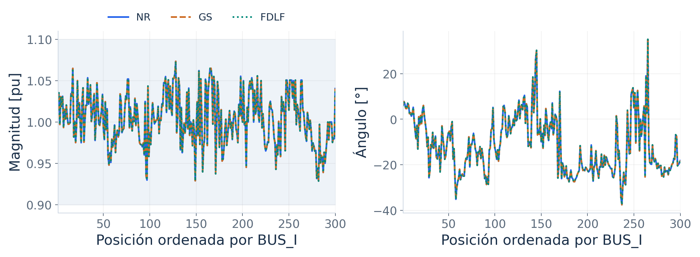

La magnitud de referencia varía aproximadamente de 0.928711 a 1.0735 pu. IEEE-300 tiene identificadores no consecutivos: la mínima corresponde a la barra 9033, sin que ello signifique que existan más de nueve mil barras. En sus gráficas se usa la posición de cada barra después de ordenar por BUS_I, manteniendo el identificador real en las tablas.

Las dos iteraciones NR, frente a tres en IEEE-118, no demuestran que un problema mayor sea más fácil en general: cambian también topología, parámetros y distancia de la condición inicial a la solución.

### 8.4. Resumen del estado y diagnósticos

<!-- BEGIN:tensiones -->

| Caso | VM mínima (pu) | BUS_I mín. | VM máxima (pu) | BUS_I máx. |
| --- | ---: | ---: | ---: | ---: |
| IEEE-14 | 1.010000 | 3 | 1.090000 | 8 |
| IEEE-118 | 0.943000 | 76 | 1.050000 | 10 |
| IEEE-300 | 0.928711 | 9033 | 1.073500 | 149 |

<!-- END:tensiones -->

Los extremos deben interpretarse junto con las entradas y no únicamente con un intervalo genérico de tensión. La presencia de un valor bajo puede motivar un estudio posterior de soporte reactivo, pero aquí no se calculan márgenes de estabilidad ni medidas correctivas.

<!-- BEGIN:diagnosticos -->

| Caso | Barras fuera de VMIN/VMAX | PV fuera de Q agregado | Ramas activas con RATE_A |
| --- | ---: | ---: | ---: |
| IEEE-14 | 0 | 0 | 0 / 20 |
| IEEE-118 | 0 | 6 | 0 / 186 |
| IEEE-300 | 0 | 11 | 0 / 411 |

Diagnóstico posterior sobre Newton-Raphson, con tolerancia 1e-8 pu para tensión y 1e-6 MVAr para límites Q. Una PV se cuenta si la Q total requerida excede la suma de los límites de sus generadores activos. Esto no es una nueva corrida con límites Q aplicados. 

En IEEE-118 se detectan 6 barras PV fuera del intervalo Q agregado: BUS_I = 19, 32, 34, 92, 103, 105. El resultado sigue siendo una solución de las ecuaciones sin aplicar límites Q, pero no acredita factibilidad reactiva. La Slack no está incluida en este recuento.

En IEEE-300 se detectan 11 barras PV fuera del intervalo Q agregado: BUS_I = 10, 20, 156, 170, 171, 236, 7003, 7055, 7062, 7071, 9002. El resultado sigue siendo una solución de las ecuaciones sin aplicar límites Q, pero no acredita factibilidad reactiva. La Slack no está incluida en este recuento.

Ninguno de los tres libros dispone de RATE_A positivo en las ramas activas; no puede concluirse ausencia de sobrecargas térmicas.

<!-- END:diagnosticos -->

<!-- BEGIN:escenario1 -->

## 9. Escenario 1 de la guía: salida de la línea 26–30

### 9.1. Caso base, fuente publicada y localización

La entrada es `data/IEEE118.xlsx`, cotejada con `data/case118.m` oficial de MATPOWER 8.1. Son 118 barras, 186 ramas (9 con tap no unitario y 177 restantes), 54 registros de generadores activos y 99 barras con PD o QD no nulos. La Slack es la barra 69 y la base es 100 MVA. Carga total: 4242.000 MW y 1438.000 MVAr. Generación programada de entrada: 4377.400 MW y 0.000 MVAr; QG=0 de entrada no impone Q=0 en PV/Slack. PG programada incluye 516,4 MW en la Slack; su generación resuelta es distinta porque cierra el balance.

Los niveles nominales leídos son **138, 161 y 345 kV**: la barra 87 es de 161 kV. La guía destaca 138/345 kV, pero no debe ocultarse el nivel adicional presente en el archivo oficial. Las barras 26 y 30 sí son ambas de 345 kV.

![Unifilar publicado por R. Christie, University of Washington, archivo IEEE-118, mayo de 1993; sistema AEP de diciembre de 1962. Fuente [5], escaneo original 118bus6.tif, no topología generada por el proyecto.](escenario1_assets/IEEE118_unifilar_UW.png)


Fuente directa: https://labs.ece.uw.edu/pstca/pf118/118bus6.tif. Procedencia y advertencias: `escenario1_assets/README_FUENTES.md` y `fuente_unifilar.json`.

### 9.2. Única modificación y opciones comunes

Se conserva intacto el caso base. En `data/IEEE118_escenario1.xlsx`, hoja `branch`, **K39 (STATUS de la rama 38, 26–30) cambia de 1 a 0**, con resaltado amarillo/naranja. Ningún otro valor de ninguna hoja cambia; conservar la fila mantiene la identidad de las 186 ramas y deja 185 activas. No se retira generación, no se cambia carga ni se anulan capacitores de barras.

La rama tiene R=0,00799 pu, X=0,086 pu y BR_B=0,908 pu. Ponerla fuera de servicio elimina tanto la admitancia serie como su carga capacitiva. No equivale a mantener su capacitor conectado.

Ambos casos usan tolerancia 1e-8 pu, máximo 1000 iteraciones, relajación GS=1,5, inicialización VM/VA del Excel y VG activa (no perfil plano), límites Q desactivados. `main` muestra el mismatch de cada iteración con `verbose=true`. La evidencia de cálculo se conserva en `escenario1_assets/ejecucion.json` y su log; esa ejecución automatizada **no acredita una grabación continua ni voces del grupo**.

### 9.3. Tres métodos: tabla exigida del caso base

| Método | Iter. | Tiempo (s) | Mismatch (pu) | P slack (MW) | P ramas (MW) | Q ramas (MVAr) |
| --- | ---: | ---: | ---: | ---: | ---: | ---: |
| Newton-Raphson | 3 | 0.512477 | 1.488e-12 | 513.862872 | 132.862872 | -557.947423 |
| Gauss-Seidel | 757 | 0.593610 | 9.875e-09 | 513.862878 | 132.862872 | -557.947420 |
| Desacoplado rápido | 9 | 0.128876 | 2.745e-09 | 513.862872 | 132.862872 | -557.947423 |

### 9.4. Tres métodos en el escenario modificado

| Método | Iter. | Tiempo (s) | Mismatch (pu) | P slack (MW) | P ramas (MW) | Q ramas (MVAr) |
| --- | ---: | ---: | ---: | ---: | ---: | ---: |
| Newton-Raphson | 4 | 0.120533 | 4.292e-14 | 546.897686 | 165.897686 | -312.669970 |
| Gauss-Seidel | 909 | 0.712572 | 9.860e-09 | 546.897680 | 165.897685 | -312.669973 |
| Desacoplado rápido | 11 | 0.059354 | 1.943e-09 | 546.897686 | 165.897686 | -312.669970 |

Los tiempos son observaciones guardadas, incluyen solución, ensamblado y escritura de consola cuando verbose está activo, y excluyen lectura/exportación Excel y gráficas. Sin repeticiones ni control del calentamiento no permiten afirmar que la contingencia sea más rápida por observar un tiempo NR menor.

### 9.5. Tabla obligatoria base–escenario

| Variable | Caso base | Escenario 1 | Diferencia |
| --- | --- | --- | --- |
| Tensión mínima (pu) y barra | 0.943000 (barra 76) | 0.940040 (barra 21) | -0.002960 pu; 76 → 21 |
| Tensión máxima (pu) y barra | 1.050000 (barra 10) | 1.050000 (barra 10) | 0,000000 pu; misma barra |
| Barras fuera de 0,95–1,05 pu | 3 | 6 | +3 |
| P de la barra slack 69 (MW) | 513.862872 | 546.897686 | +33.034814 |
| Q de la barra slack 69 (MVAr) | -82.424057 | -79.013080 | +3.410977 |
| Pérdidas totales (MW) | 132.862872 | 165.897686 | +33.034814 |
| Iteraciones Newton-Raphson | 3 | 4 | +1 |
| Iteraciones Gauss-Seidel | 757 | 909 | +152 |

Referencia eléctrica: NR convergente; GS y FDLF sirven como contraste interno. El Excel `comparacion_escenario1.xlsx`, hoja `comparacion`, conserva valores numéricos y separa las barras de los extremos en filas propias: no se resta un identificador de barra como si fuera una magnitud física.

### 9.6. Cinco barras de menor tensión y cinco ramas de mayor flujo

**Cinco tensiones más bajas del caso base:**

| Barra | Tensión (pu) | Ángulo (°) |
| --- | ---: | ---: |
| 76 | 0.943000 | 21.798787 |
| 53 | 0.945983 | 14.436149 |
| 118 | 0.949438 | 21.941867 |
| 55 | 0.952000 | 15.058217 |
| 107 | 0.952000 | 17.582668 |

**Cinco tensiones más bajas del escenario:**

| Barra | Tensión (pu) | Ángulo (°) |
| --- | ---: | ---: |
| 21 | 0.940040 | 15.250382 |
| 76 | 0.943000 | 22.097690 |
| 20 | 0.944840 | 11.485765 |
| 53 | 0.946003 | 12.954110 |
| 118 | 0.949576 | 22.420009 |

**Cinco ramas de mayor potencia aparente del caso base:**

| Rama | Desde–Hasta | S desde (MVA) | S hasta (MVA) | S máxima (MVA) |
| --- | ---: | ---: | ---: | ---: |
| 9 | 9–10 | 445.924293 | 452.885528 | 452.885528 |
| 7 | 8–9 | 449.679150 | 445.924293 | 449.679150 |
| 8 | 8–5 | 360.724137 | 350.757087 | 360.724137 |
| 51 | 38–37 | 268.580742 | 258.796980 | 268.580742 |
| 36 | 30–17 | 249.180028 | 241.581307 | 249.180028 |

**Cinco ramas de mayor potencia aparente del escenario:**

| Rama | Desde–Hasta | S desde (MVA) | S hasta (MVA) | S máxima (MVA) |
| --- | ---: | ---: | ---: | ---: |
| 9 | 9–10 | 445.924293 | 452.885528 | 452.885528 |
| 7 | 8–9 | 449.679150 | 445.924293 | 449.679150 |
| 8 | 8–5 | 338.734293 | 329.332873 | 338.734293 |
| 32 | 26–25 | 316.195271 | 314.014614 | 316.195271 |
| 31 | 23–25 | 290.351879 | 307.163492 | 307.163492 |

Se usa **S máxima = max(S desde, S hasta)**, no solo el extremo de origen. MVA es magnitud aparente, no transferencia activa MW. `Loading_percent` del libro no es un criterio de ordenación para estas tablas; RATE_A=0 significa capacidad no disponible, no una capacidad física nula.

### 9.7. Flujo de la línea retirada y cinco mayores cambios

| Extremo de la rama 26–30 | P (MW) | Q (MVAr) | S (MVA) |
| --- | ---: | ---: | ---: |
| Desde 26 | 223.710922 | -11.459893 | 224.004254 |
| Desde 30 | -219.732807 | -36.572030 | 222.755516 |

En el caso base transfiere 223.710922 MW desde 26 y entrega 219.732807 MW a 30, con 3.978115 MW de pérdida propia y -48.031923 MVAr netos. En el escenario todos sus flujos son cero (reducción de S máxima: −100 %). Se muestra aparte: no ocupa un puesto entre las cinco ramas activas con mayor cambio.

**Cinco mayores cambios globales exigidos por la guía (incluida la línea retirada):**

| Rama | Desde–Hasta | Base (MVA) | Escenario (MVA) | Δ MVA | Δ % |
| --- | ---: | ---: | ---: | ---: | ---: |
| 38 | 26–30 | 224.004254 | 0.000000 | -224.004254 | -100.000 |
| 32 | 26–25 | 92.833255 | 316.195271 | +223.362016 | +240.606 |
| 31 | 23–25 | 171.179412 | 307.163492 | +135.984080 | +79.440 |
| 36 | 30–17 | 249.180028 | 129.065281 | -120.114746 | -48.204 |
| 33 | 25–27 | 146.638000 | 233.715145 | +87.077145 | +59.382 |

El ranking global corresponde a `cambios_top5_total`: 26–30, 26–25, 23–25, 30–17 y 25–27. La retirada encabeza el cambio absoluto (−224,004254 MVA, −100 %). No se la excluye del ranking solicitado.

**Complemento: cinco ramas activas para estudiar la redistribución:**

| Rama | Desde–Hasta | Base (MVA) | Escenario (MVA) | Δ MVA | Δ % |
| --- | ---: | ---: | ---: | ---: | ---: |
| 32 | 26–25 | 92.833255 | 316.195271 | +223.362016 | +240.606 |
| 31 | 23–25 | 171.179412 | 307.163492 | +135.984080 | +79.440 |
| 36 | 30–17 | 249.180028 | 129.065281 | -120.114746 | -48.204 |
| 33 | 25–27 | 146.638000 | 233.715145 | +87.077145 | +59.382 |
| 179 | 32–113 | 18.268330 | 68.546911 | +50.278581 | +275.223 |

Las cinco filas complementarias se ordenan por |ΔS| en ramas activas en ambos casos; ΔS=S escenario−S base y Δ%=100·ΔS/S base. La reducción 30–17 forma parte del top5 por magnitud absoluta, aunque no es un aumento. Los porcentajes grandes sobre bases pequeñas no implican sobrecarga. Las sumas de MVA de estas ramas no son un balance conservativo de MW: cambian reactiva, pérdidas, signos y flujos de malla.

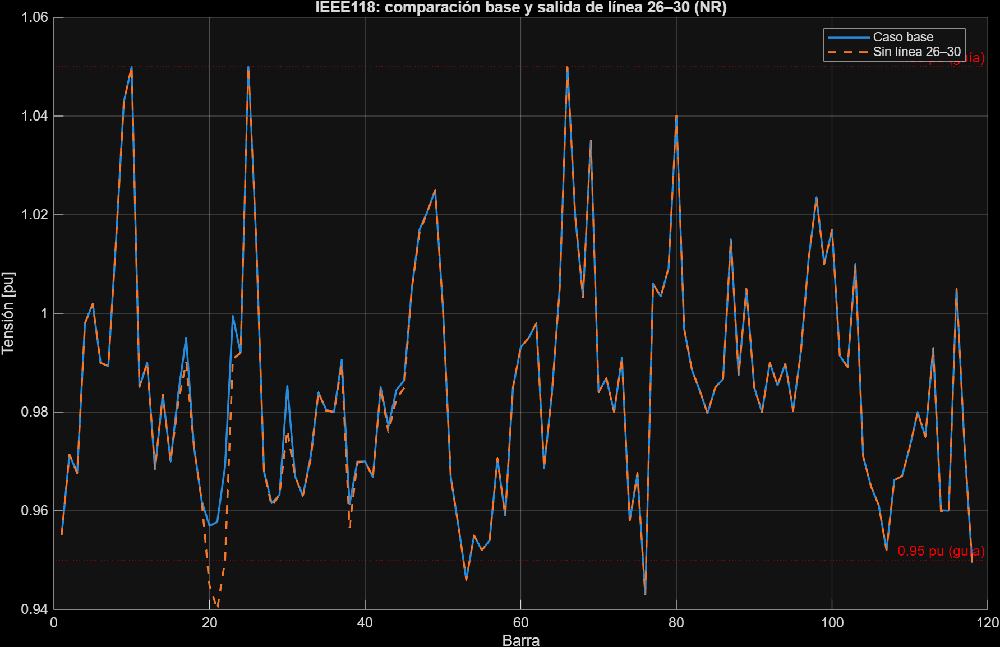

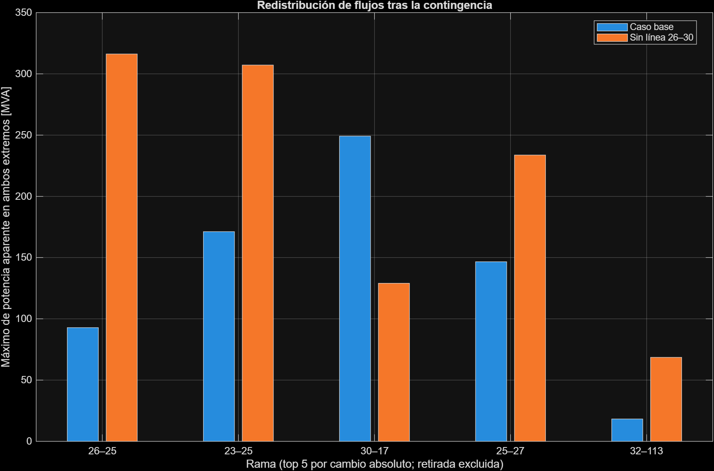

### 9.8. Respuestas numéricas a las tres preguntas del escenario

**1. ¿Hacia qué líneas se redistribuyó la potencia y cuánto aumentó su flujo?** La salida elimina el camino 26–30. El enlace 26–25 (transformador con tap 0,96) aumenta de 92,833255 a 316,195271 MVA: **+223,362016 MVA (+240,606 %)**. Las ramas 23–25, 25–27 y 32–113 aumentan respectivamente **135,984080 MVA (+79,440 %)**, **87,077145 MVA (+59,382 %)** y **50,278581 MVA (+275,223 %)**. La rama 30–17 disminuye **120,114746 MVA (−48,204 %)**. Los flujos P/Q firmados de `NR_branch` permiten seguir el sentido real; las etiquetas Desde–Hasta no indican por sí solas dirección de transferencia.

**2. ¿Alguna barra quedó fuera de 0,95–1,05 pu?** Sí. En base son **53, 76 y 118**; en escenario son **20, 21, 22, 53, 76 y 118**: tres adicionales y ninguna por encima de 1,05 pu. La mínima pasa de **0,943000 pu en 76** a **0,940040 pu en 21**. La barra 76 es PV con consigna 0,943 pu, de modo que su subtensión frente a la guía ya estaba programada; no todo incumplimiento lo produce la contingencia.

| Caso | Barra | VM (pu) | Desviación respecto a 0,95 (pu) |
| --- | ---: | ---: | ---: |
| Base | 53 | 0.945983 | -0.004017 |
| Base | 76 | 0.943000 | -0.007000 |
| Base | 118 | 0.949438 | -0.000562 |
| Escenario 1 | 20 | 0.944840 | -0.005160 |
| Escenario 1 | 21 | 0.940040 | -0.009960 |
| Escenario 1 | 22 | 0.949862 | -0.000138 |
| Escenario 1 | 53 | 0.946003 | -0.003997 |
| Escenario 1 | 76 | 0.943000 | -0.007000 |
| Escenario 1 | 118 | 0.949576 | -0.000424 |

El conteo usa margen numérico 1e-8 pu en los bordes. No debe confundirse con VMIN=0,94 y VMAX=1,06 del Excel: ambos casos permanecen dentro de esos límites más amplios. Cumplir VMIN/VMAX no elimina los seis incumplimientos del intervalo exigido por la guía.

**3. ¿Aumentaron o disminuyeron las pérdidas y por qué?** Aumentan de **132.862872 a 165.897686 MW**, esto es **+33.034814 MW (+24.864 %)**. Aunque desaparecen los 3,978115 MW de pérdida propia de 26–30, la redistribución aumenta corrientes en otros caminos; las pérdidas resistivas dependen de I²R y del nuevo estado AC, no solo del número de líneas. La carga total y PG no Slack no cambian, y GS nodal es cero: por balance, el aumento de P Slack **+33.034814 MW** coincide con el aumento de pérdidas.

La suma Q neta de ramas cambia de **-557.947423 a -312.669970 MVAr** (Δ=+245.277454 MVAr). Es absorción inductiva menos aporte capacitivo de líneas, no disipación resistiva negativa. Al retirar la línea se pierde también su aporte capacitivo. Los BS de barras no cambian, pero sus aportes dependen de V²; la diferencia Q no se atribuye exclusivamente al capacitor retirado. La Slack pasa de -82.424057 a -79.013080 MVAr: sigue absorbiendo reactiva, aunque menos.

### 9.9. Validación externa publicada del caso base

Referencia independiente: solución AC NR de **MATPOWER 8.1, case118.m oficial**, con tolerancia 1e-10 pu y límites Q desactivados. No es una tabla publicada de tensiones copiada ni una comparación entre métodos propios: MATPOWER es el software publicado [1, 4] y su caso oficial la referencia reproducible. Los detalles barra por barra VM/VA se conservan en `validacion_MATPOWER.xlsx`.

| Método | Error VM (pu) | Error VA (°) | Error P pérdidas (MW) | Error Q ramas (MVAr) | Error P slack (MW) | Error Q slack (MVAr) |
| --- | ---: | ---: | ---: | ---: | ---: | ---: |
| Newton-Raphson | 8.882e-16 | 8.527e-14 | 6.281e-12 | 4.775e-12 | 3.524e-12 | 2.558e-13 |
| Gauss-Seidel | 9.893e-11 | 3.472e-07 | 4.581e-07 | 2.978e-06 | 6.367e-06 | 3.915e-07 |
| Desacoplado rápido | 5.034e-11 | 6.887e-09 | 2.568e-09 | 7.105e-09 | 4.808e-08 | 2.344e-09 |

| Magnitud base | Propia NR | MATPOWER NR |
| --- | ---: | ---: |
| P pérdidas (MW) | 132.862871889 | 132.862871889 |
| Q neta ramas (MVAr) | -557.947423122 | -557.947423122 |
| P Slack 69 (MW) | 513.862871889 | 513.862871889 |
| Q Slack 69 (MVAr) | -82.424057292 | -82.424057292 |

Las diferencias de Q neta de ramas y P/Q de la slack están presentes en la validación externa y se muestran en la tabla. Las referencias absolutas se conservan en el resumen del Excel de validación.

Esta tabla valida el **caso base**, no certifica externamente el escenario: su contraste NR/GS/FDLF es interno. La validación completa y los umbrales se desarrollan en la sección 11 y `VALIDACION_EXTERNA.md`.

### 9.10. Conclusiones, diagnóstico y recomendación

Los tres métodos convergen en ambos estados con residual menor que 1e-8 pu. NR pasa de **3 a 4** iteraciones, GS de **757 a 909** y FDLF de **9 a 11**: la contingencia exige más pasos en los tres, pero esto solo demuestra robustez en esta perturbación e inicialización. Las tablas 9.3–9.4 documentan precisión y tiempos sin convertir iteraciones de distinto coste en unidades equivalentes.

El escenario es **no aceptable respecto al criterio de tensión de la guía**: seis barras por debajo de 0,95 pu, mínima 0,940040 pu, y pérdidas +24,864 %. No se demuestra colapso de tensión, estabilidad dinámica ni sobrecarga térmica. RATE_A=0 en las ramas impide acreditar un margen térmico y los límites Q están desactivados; convergencia no equivale a factibilidad operativa.

Recomendación: priorizar la restitución del corredor 26–30 cuando sea viable y estudiar regulación/soporte reactivo y redespacho en la zona 20–22. Antes de recomendar un tamaño de capacitor o declarar seguridad N-1, repetir con límites Q/P efectivos, capacidades térmicas válidas y análisis de estabilidad. Este estudio no dimensiona equipos ni calcula márgenes de colapso.

### 9.11. Reproducción y frontera de la evidencia

Desde una terminal: `python tools/prepare_scenario1.py`. En MATLAB, después de `addpath('matlab')`: `study = run_video_project(false);`. Para regenerar solo los documentos, sin ejecutar MATLAB: `python tools/build_report.py` o `python tools/build_video_report.py`. Dependencias y comandos completos: `GUIA_USO_MATLAB.md` y `MATLAB_README.md`.

Para el video se debe mostrar el código, ambos Excel de entrada y salida, y grabar cada corrida sin cortes ni aceleración desde el lanzamiento hasta la exportación. Las capturas, logs y pruebas automáticas no satisfacen ese requisito audiovisual. Nombres de integrantes, voces identificadas, MP4 1080p de 30–40 minutos y entrega al TEC Digital un día antes siguen **PENDIENTES humanos**, trazados individualmente en `CUMPLIMIENTO_GUIA_VIDEO.md`.

<!-- END:escenario1 -->

## 10. Comparativa e interpretación física y numérica

### 10.1. Acuerdo interno y coste

Los tres métodos resuelven las mismas ecuaciones y conservan la misma Slack. En los casos verificados, las diferencias máximas de magnitud respecto a NR son menores que `1.2e-9 pu`, las angulares menores que `3.5e-7 grados` y las de pérdidas activas menores que `6e-7 MW`. La tolerancia en potencia y el condicionamiento del sistema explican que los errores de estado no coincidan numéricamente con `1e-8`.

<!-- BEGIN:acuerdo_interno -->

| Caso | Máx. diferencia VM (pu) | Máx. diferencia VA (°) | Diferencia P ramas (MW) |
| --- | ---: | ---: | ---: |
| IEEE-14 | `1.175e-09` | `1.602e-07` | `2.303e-07` |
| IEEE-118 | `9.893e-11` | `3.472e-07` | `4.581e-07` |
| IEEE-300 | `3.094e-10` | `3.144e-07` | `5.770e-07` |

<!-- END:acuerdo_interno -->

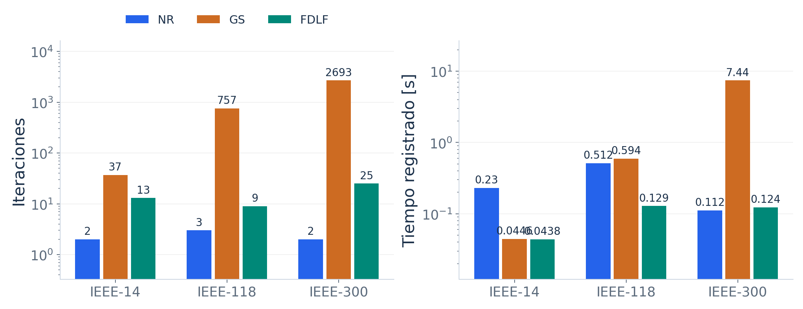

NR realiza pocas iteraciones con trabajo matricial considerable. GS requiere muchas pasadas y añade reevaluaciones globales en PV. FD evita reconstruir el Jacobiano, pero resuelve dos sistemas por paso y evalúa el modelo completo entre etapas. Una iteración de cada método no es una unidad de trabajo equivalente.

Además, Ybus, el Jacobiano y las matrices desacopladas son densos. La memoria crece cuadráticamente con la dimensión y una resolución densa general puede tener coste cúbico. Estas observaciones describen tendencias algorítmicas, no un ajuste experimental de complejidad a partir de tres casos heterogéneos.

### 10.2. Flujos de rama y balance activo

`calculate_branch_flows.m` usa las mismas cuatro admitancias de rama que la construcción nodal. Las potencias en cada extremo se consideran positivas entrando a la rama desde su barra. Por eso una transferencia sin pérdidas tendría signos opuestos en los dos extremos; la pérdida activa es su suma, no la diferencia de sus valores absolutos.

```math
S_f = S_("base") V_f overline(I_f), quad S_t = S_("base") V_t overline(I_t)
```

```math
P_("rama") = "Re"(S_f + S_t), quad Q_("rama") = "Im"(S_f + S_t)
```

La suma de pérdidas activas de ramas no incluye las conductancias shunt de barras. Como la generación calculada se reconstruye desde Ybus completa, el balance global correcto es:

```math
sum_i P_(G i) - sum_i P_(D i) = sum_l P_("rama", l) + sum_i "GS"_i U_i^2
```

<!-- BEGIN:balance_activo -->

| Caso | P generación | P demanda | P ramas | P shunts |
| --- | ---: | ---: | ---: | ---: |
| IEEE-14 | 272.393272 | 259.000000 | 13.393272 | 0.000000 |
| IEEE-118 | 4374.862872 | 4242.000000 | 132.862872 | 0.000000 |
| IEEE-300 | 23657.056271 | 23246.860000 | 408.985541 | 1.210731 |

Todas las potencias están en MW. Máximo residuo de balance activo: `9.089e-12 MW`. Las conductancias shunt de IEEE-300 se evalúan a la tensión resuelta.

<!-- END:balance_activo -->

Esta distinción es esencial en IEEE-300: a los **408.98554 MW** de ramas se añaden aproximadamente **1.2107 MW** de shunts de barras. El consumo activo total de la red es, por tanto, cercano a 410.1963 MW. Comparar generación menos demanda únicamente con las ramas produciría un aparente error que en realidad corresponde a elementos explícitos del modelo.

### 10.3. Balance reactivo y significado de valores negativos

La reactiva neta de una rama incorpora absorción inductiva y carga capacitiva. Su suma puede ser negativa sin que exista una pérdida resistiva negativa. Las sumas de referencia son aproximadamente 30.122388 MVAr en IEEE-14, −557.947423 MVAr en IEEE-118 y −393.844117 MVAr en IEEE-300.

Las derivaciones nodales añaden otro término con signo propio:

```math
sum_i Q_(G i) - sum_i Q_(D i) = sum_l Q_("rama", l) - sum_i "BS"_i U_i^2
```

<!-- BEGIN:balance_reactivo -->

| Caso | Q generación | Q demanda | Q ramas | Q shunts |
| --- | ---: | ---: | ---: | ---: |
| IEEE-14 | 82.437544 | 73.500000 | 30.122388 | -21.184844 |
| IEEE-118 | 795.683977 | 1438.000000 | -557.947423 | -84.368600 |
| IEEE-300 | 7993.661076 | 7787.970000 | -393.844117 | 599.535192 |

Potencias en MVAr; Q shunts es absorción neta, negativa si hay aporte capacitivo. Máximo residuo reactivo: `2.274e-11 MVAr`.

<!-- END:balance_reactivo -->

Una susceptancia positiva aporta reactiva a la barra y aparece con signo negativo en el consumo de red. Omitir ese signo o confundir `BS` con una demanda explicaría discrepancias artificiales. Los balances deben calcularse con valores completos; el redondeo de tablas puede dejar residuos pequeños.

### 10.4. Lectura operativa prudente

La generación calculada por barra es inyección más demanda local. En Slack ajusta el balance; en PV la reactiva responde al control de magnitud. No se obtiene un despacho individual detallado cuando hay varias unidades en la misma barra. El programa tampoco redistribuye automáticamente la activa para satisfacer `PMAX` o `PMIN`.

La columna `Loading_percent` compara la potencia aparente del extremo de origen con `RATE_A` cuando este es positivo. No utiliza el máximo de ambos extremos, y un límite ausente o nulo deja el indicador sin valor útil. Por tanto, no debe presentarse como una comprobación térmica integral. Similarmente, convergencia numérica no significa que todos los límites Q, tensiones o capacidades se respeten.

## 11. Validación externa con MATPOWER

### 11.1. Referencia y procedimiento

Se utilizó MATPOWER 8.1 [1, 4], con Newton-Raphson AC, tolerancia `1e-10 pu`, máximo de 30 iteraciones y límites Q desactivados. La implementación propia mantuvo `1e-8 pu`. La comparación emplea datos equivalentes y las mismas consignas; no exige igualdad de iteraciones entre implementaciones.

`validate_against_matpower.m` convierte los datos, ejecuta la referencia y empareja barras por identificador. Comprueba también orden y extremos de ramas. Los ángulos se comparan módulo 360 grados para no atribuir a un salto de representación una discrepancia física. MATPOWER se incorpora al path durante esa validación y el path previo se restaura al finalizar; no interviene en los cálculos de `main` ni de la GUI.

### 11.2. Criterios y resultados

Los umbrales del proyecto son `1e-7 pu` para magnitud, `1e-5 grados` para ángulo y `1e-4 MW` o `MVAr` para flujos de ambos extremos. Las sumas de pérdidas activas y Q neta de ramas, y la potencia P/Q de la Slack, deben diferir en no más de `1e-4 MW` o `MVAr`, según corresponda. La tabla 9.9 incluye estos controles adicionales de IEEE-118 y sus valores de referencia. También se exige éxito de la referencia y convergencia propia con su tolerancia. Son criterios adoptados por el proyecto, no una norma IEEE.

<!-- BEGIN:validacion_tensiones -->

| Caso | Método | Error VM (pu) | Error VA (°) | Aceptación |
| --- | --- | ---: | ---: | --- |
| IEEE14 | NR | `5.480e-12` | `2.620e-10` | Sí |
| IEEE14 | GS | `2.957e-10` | `1.604e-07` | Sí |
| IEEE14 | FD | `1.175e-09` | `1.616e-08` | Sí |
| IEEE118 | NR | `8.882e-16` | `8.527e-14` | Sí |
| IEEE118 | GS | `9.893e-11` | `3.472e-07` | Sí |
| IEEE118 | FD | `5.034e-11` | `6.887e-09` | Sí |
| IEEE300 | NR | `5.218e-15` | `1.194e-12` | Sí |
| IEEE300 | GS | `2.182e-10` | `3.144e-07` | Sí |
| IEEE300 | FD | `3.094e-10` | `1.709e-08` | Sí |

<!-- END:validacion_tensiones -->

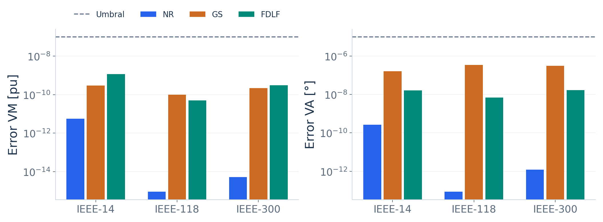

<!-- BEGIN:validacion_flujos -->

| Caso | Método | Error P rama (MW) | Error Q rama (MVAr) | Error P total (MW) |
| --- | --- | ---: | ---: | ---: |
| IEEE14 | NR | `3.275e-09` | `5.223e-09` | `4.670e-10` |
| IEEE14 | GS | `1.863e-06` | `7.512e-07` | `2.308e-07` |
| IEEE14 | FD | `5.434e-07` | `3.610e-07` | `7.469e-09` |
| IEEE118 | NR | `3.922e-12` | `2.736e-12` | `6.281e-12` |
| IEEE118 | GS | `3.201e-06` | `5.450e-07` | `4.581e-07` |
| IEEE118 | FD | `1.844e-07` | `1.351e-08` | `2.568e-09` |
| IEEE300 | NR | `1.953e-11` | `8.481e-11` | `9.209e-12` |
| IEEE300 | GS | `5.924e-06` | `8.171e-07` | `5.770e-07` |
| IEEE300 | FD | `6.649e-07` | `5.565e-08` | `3.008e-09` |

<!-- END:validacion_flujos -->

Las **nueve comparaciones aprobaron**. Los errores observados fueron menores que `1.2e-9 pu` en magnitud, `3.5e-7 grados` en ángulo, `6e-6 MW` en flujo activo y `9e-7 MVAr` en flujo reactivo. Las diferencias de pérdidas activas fueron menores que `5.8e-7 MW`. Son resultados calculados por el procedimiento del repositorio; no se atribuyen a una tabla publicada en un artículo.

### 11.3. Evidencia y alcance de la conclusión

`validacion_MATPOWER.xlsx` contiene resumen, metadatos y diferencias por barra y rama. El JSON registra versión MATLAB, MATPOWER, fecha UTC, tolerancias, cotejo oficial IEEE-118 y aceptación. `VALIDACION_EXTERNA.md` explica descarga, criterios y procedencia.

El instalador `tools/setup_matpower.py` fija la versión 8.1 y verifica el SHA-256 del archivo oficial antes de extraerlo. Esa fijación reduce ambigüedades de versión, aunque conservar el código y las entradas sigue siendo necesario para reproducir exactamente una comparación.

La validación es especialmente relevante por la corrección de `VG`: antes existía acuerdo entre métodos que imponían la misma consigna equivocada. La referencia independiente permitió distinguir consistencia interna de corrección del problema resuelto. Aun así, validar nueve estados no demuestra ausencia de defectos para cualquier red, inicialización, isla o activación de límites.

## 12. Pruebas y controles implementados

### 12.1. Regresión numérica

`test_powerflow.m` carga los tres casos y verifica dimensiones, nombre, tamaño de Ybus y finitud de sus elementos. Para cada método exige convergencia, tensiones finitas y un residual recalculado que cumpla la tolerancia. También comprueba acuerdo entre tensiones complejas, respeto de `VG` y conservación del ángulo Slack. En IEEE-300 confirma el aumento del máximo sin modificar la tolerancia.

El residual se recalcula fuera del campo resumido del resultado, lo que evita aceptar simplemente una etiqueta de éxito. No obstante, sigue utilizando las funciones compartidas del modelo; por ello esa comprobación es interna y complementaria a MATPOWER, no una segunda implementación independiente de las ecuaciones.

### 12.2. Regresiones de consignas y estados

Las pruebas fuerzan diferencias entre `VM` y `VG` en Slack y PV y comparan el wrapper con llamadas directas a los tres solucionadores. Incluyen un generador en PQ cuya `VG` no debe imponer tensión, varias unidades activas con consigna compatible y unidades inactivas con potencias extremas que no deben afectar el resultado.

Se verifica que una PV sin unidad activa sea equivalente a una PQ explícita y que su magnitud pueda cambiar. Se comprueba el rechazo de consignas contradictorias, valores cero, negativos, complejos o no finitos, tensiones iniciales PQ inválidas y Slack sin generación activa. Los errores esperados se contrastan mediante sus identificadores, no solo mediante un mensaje genérico.

### 12.3. Excel, valores por defecto e interfaz

La suite escribe libros temporales sin `VG`, invierte el orden de filas y confirma que el respaldo se asocia por identificador. Comprueba también la preservación de una columna `VG` explícita y el rechazo de entradas inválidas desde Excel. Verifica resolución de rutas por defecto incluso desde otro directorio, selección de IEEE-118 y nombres de salida derivados del caso.

En las exportaciones temporales se comprueban hojas, número de filas, valores de tensión, convergencia y longitud del historial: iteraciones más uno por incluir el estado inicial. El registro `verificacion_MATLAB.log` conserva la aprobación de la suite y comprobaciones técnicas de consola, gráficas y GUI. `test_app_flows` cubre además la secuencia base→salida 26–30→restauración, comparación y exportación temporal, flujos nulos de la retirada e invalidación al editar datos/opciones. Comprueba que las entradas y los libros de evidencia del proyecto permanezcan intactos; no constituye una certificación exhaustiva de todos los eventos ni una grabación del video.

### 12.4. Cobertura que no debe suponerse

La suite examinada no demuestra cobertura exhaustiva de límites Q activos, islas, topologías arbitrarias o cercanía al colapso de tensión. Tampoco presenta mediciones de cobertura de líneas ni pruebas aleatorias masivas. La evidencia existente es suficiente para describir las regresiones concretas anteriores; ampliar sus afirmaciones exigiría nuevos casos y criterios de aceptación.

<!-- BEGIN:archivos_evidencia -->

| Archivo | Modificado (UTC) | SHA-256, prefijo |
| --- | --- | --- |
| `resultados_IEEE14_matlab.xlsx` | 2026-11-07 22:43:49 | `e6368d7da8ca` |
| `resultados_IEEE118_matlab.xlsx` | 2026-11-15 04:28:14 | `e93920c849c9` |
| `resultados_IEEE300_matlab.xlsx` | 2026-11-07 22:44:00 | `c1cff1c2d6be` |
| `validacion_MATPOWER.xlsx` | 2026-11-15 04:31:10 | `f9996b322e0d` |
| `validacion_MATPOWER.json` | 2026-11-15 04:31:10 | `898e84b23685` |
| `IEEE14.xlsx` | 2026-08-28 14:36:12 | `899788cb6e0f` |
| `IEEE118.xlsx` | 2026-08-21 16:50:50 | `ed5db20ffdad` |
| `IEEE300.xlsx` | 2026-08-28 14:08:32 | `9962150e111c` |

Los hashes completos y la fecha de compilación están en `informe_assets/datos_informe.json`. Las fechas anteriores son de modificación de archivos, no una certificación de cuándo comenzó cada cálculo.

<!-- END:archivos_evidencia -->

## 13. Limitaciones, recomendaciones y conclusiones

### 13.1. Limitaciones

La representación densa limita el escalamiento en memoria y tiempo. La validación estructural exige una única Slack y referencias válidas, pero no desarrolla un análisis exhaustivo de conectividad ni asigna referencias independientes por isla. Una matriz singular o una divergencia puede ser consecuencia de una red desconectada, un estado inicial inadecuado o un problema mal condicionado; el mensaje final por sí solo no identifica siempre la causa.

Los algoritmos carecen de estrategias avanzadas de globalización. El aumento del máximo de iteraciones permite completar GS en IEEE-300, pero no convierte una trayectoria divergente en convergente. La opción de límites Q es agregada, no opera sobre Slack y no demuestra factibilidad individual de unidades. Los casos base y el escenario 1 no aplican esa opción.

Las tablas de tiempo no proceden de un diseño estadístico y los casos no constituyen una secuencia homogénea de tamaños. No es válido deducir una ley de rendimiento ni universalizar el orden de rapidez observado. Los casos estándar tampoco representan validación de una red regional real. El escenario 1 demuestra una sola salida de línea, no robustez general frente a cualquier contingencia.

### 13.2. Recomendaciones priorizadas

Las nuevas corridas conservan base MVA y opciones en los Excel IEEE-118, versión y estado de grabación en `escenario1_assets/ejecucion.json`, y huellas en `informe_assets/manifest_video.json`. Debe mantenerse este mecanismo para futuras corridas, evitando mezclar libros corregidos y antiguos. La segunda es ampliar las pruebas de límites Q, conectividad y fallos controlados antes de utilizar entradas más diversas.

Para rendimiento, conviene evaluar matrices dispersas, ensamblaje eficiente del Jacobiano y cálculo local de reactiva en GS. En FD podría estudiarse una factorización explícita reutilizable de matrices constantes. Estas son recomendaciones: no describen optimizaciones ya implementadas. Cualquier cambio debe mantener tolerancias, consignas y acuerdo externo.

Un estudio posterior de sensibilidad debería definir previamente perturbaciones, inicializaciones y criterios de aceptación. Un benchmark requeriría repeticiones, calentamiento, entorno documentado y separación del núcleo de cálculo del posprocesamiento. Un análisis operativo tendría que verificar capacidades por ambos extremos, límites de unidades y escenarios. En particular, habría que obtener capacidades térmicas de ramas, pues los libros empleados no contienen RATE_A positivo. No basta con añadir etiquetas de alarma a los resultados actuales.

### 13.3. Conclusiones

Los tres métodos propios convergen a estados equivalentes en IEEE-14, IEEE-118 e IEEE-300 bajo las condiciones documentadas. La solución de IEEE-118 corregida presenta 132.862872 MW de pérdidas de ramas y 757 pasadas GS. La corrección de `VG` demuestra la importancia de validar la interpretación de datos, no solo las ecuaciones iterativas.

NR ofrece pocas correcciones, FD utiliza aproximaciones constantes para corregir un residual AC completo y GS requiere más pasadas, con un coste adicional concreto por su tratamiento PV. La política de 30000 iteraciones permite completar IEEE-300 sin relajar precisión. El balance de ese caso exige sumar a las ramas las conductancias shunt.

El diagnóstico posterior también identifica barras PV fuera de sus límites reactivos agregados en IEEE-118 e IEEE-300, aun cuando no se observan desviaciones respecto de VMIN/VMAX. La coincidencia con MATPOWER debe interpretarse como validación de la solución con límites Q desactivados, no como confirmación de factibilidad operativa.

La comparación externa aprobada y las regresiones proporcionan evidencia reproducible para los casos incluidos. No sustituyen una certificación general del software ni un estudio de seguridad eléctrica. La contribución del proyecto es una implementación explicable, con entradas y resultados trazables, diferencias numéricas documentadas y una delimitación explícita de lo demostrado.

## 14. Bibliografía verificada

Las referencias siguientes sustentan el fundamento metodológico, la procedencia de los datos y la elección del software independiente. Las cifras de este informe se obtienen de las ejecuciones y comparaciones del proyecto; no se presentan como valores extraídos de tablas de esas publicaciones.

[1] R. D. Zimmerman, C. E. Murillo-Sánchez y R. J. Thomas, «MATPOWER: Steady-State Operations, Planning, and Analysis Tools for Power Systems Research and Education», *IEEE Transactions on Power Systems*, vol. 26, n.º 1, pp. 12–19, febrero de 2011. DOI: https://doi.org/10.1109/TPWRS.2010.2051168. Referencia bibliográfica del software independiente utilizado.

[2] W. F. Tinney y C. E. Hart, «Power Flow Solution by Newton's Method», *IEEE Transactions on Power Apparatus and Systems*, vol. PAS-86, n.º 11, pp. 1449–1460, noviembre de 1967. DOI: https://doi.org/10.1109/TPAS.1967.291823. Datos bibliográficos verificados mediante metadatos DOI; referencia del fundamento de Newton aplicado al flujo.

[3] B. Stott y O. Alsac, «Fast Decoupled Load Flow», *IEEE Transactions on Power Apparatus and Systems*, vol. PAS-93, n.º 3, pp. 859–869, mayo de 1974. DOI: https://doi.org/10.1109/TPAS.1974.293985. Referencia del desacoplamiento rápido, sin afirmar identidad de variantes de implementación.

[4] R. D. Zimmerman y C. E. Murillo-Sánchez, *MATPOWER*, versión 8.1, 2025, software. DOI: https://doi.org/10.5281/zenodo.15871662. Política oficial de citas: https://matpower.org/citing.

[5] R. Christie, Universidad de Washington, *Power Systems Test Case Archive: 118 Bus Power Flow Test Case*, mayo de 1993. https://labs.ece.uw.edu/pstca/pf118/pg_tca118bus.htm. Fuente de procedencia y advertencias del caso base IEEE-118.

## 15. Apéndice: diccionario de datos y uso

### 15.1. Diccionario mínimo de entrada

| Hoja o grupo | Campos | Interpretación |
|---|---|---|
| Barras | `BUS_I`, `TYPE` | Identificador único y tipo declarado: PQ 1, PV 2, Slack 3 |
| Barras | `PD`, `QD` | Demanda activa MW y reactiva MVAr |
| Barras | `VM`, `VA` | Magnitud inicial pu y ángulo inicial en grados; VM no reemplaza VG regulada |
| Barras | `GS`, `BS` | Derivaciones en MW y MVAr a tensión de 1 pu |
| Barras | `VMIN`, `VMAX`, `BASE_KV` | Información de límites y nivel nominal; no impone restricciones por sí sola |
| Generadores | `GEN_BUS`, `STATUS` | Barra asociada y estado; cero significa fuera de servicio |
| Generadores | `PG`, `QG` | Potencias de entrada MW y MVAr, agregadas por barra activa |
| Generadores | `VG` | Consigna de magnitud pu en PV y Slack con unidades activas |
| Generadores | `QMIN`, `QMAX` | Límites reactivos MVAr para la opción agregada PV a PQ |
| Generadores | `PMIN`, `PMAX`, `MBASE` | Datos conservados; no constituyen despacho óptimo |
| Ramas | `F_BUS`, `T_BUS`, `STATUS` | Extremos orientados y estado de servicio |
| Ramas | `BR_R`, `BR_X`, `BR_B` | Resistencia, reactancia y carga capacitiva total en pu |
| Ramas | `TAP`, `SHIFT` | Magnitud de transformación y desfase en grados |
| Ramas | `RATE_A` | Capacidad MVA para el indicador informativo del extremo de origen |
| Configuración | `baseMVA` | Base común; 100 MVA si falta la hoja |

### 15.2. Diccionario de resultados

`results` es un arreglo de estructuras, una por método. Los campos `method`, `converged`, `iterations`, `tolerance`, `maxMismatch` y `message` describen estado y parada. `elapsedSeconds` contiene el intervalo descrito en la metodología; `V` almacena tensiones complejas y `mismatchHistory` incluye el residual inicial.

`busResults` conserva datos de entrada y añade `VM_pu`, `VA_deg`, inyecciones calculadas y especificadas, generación calculada y demanda. `Es_variable_angulo` y `Es_variable_VM` indican las variables efectivas. La etiqueta de tipo puede reflejar el tipo declarado; los indicadores son más informativos cuando una PV sin generación se trata efectivamente como PQ.

`Error_P_MW` y `Error_Q_MVAr` muestran diferencias para todas las barras. No todas pertenecen al criterio de convergencia: la diferencia activa Slack y la reactiva PV o Slack expresan ajustes de cantidades no impuestas. Interpretarlas todas como incumplimientos produciría falsas alarmas.

`branchResults` contiene flujos de ambos extremos, potencias aparentes, sumas activa y reactiva de rama y carga informativa. `summary` reúne dimensiones, Slack, extremos de magnitud, generación, demanda y sumas de ramas. Sus pérdidas no incorporan directamente los shunts nodales; el balance global debe añadirlos con el signo correspondiente.

El libro exportado contiene `entrada_bus`, `entrada_gen`, `entrada_branch` y `comparacion`. Los prefijos `NR`, `GS` y `FDLF` identifican las hojas por barra, rama y convergencia: por ejemplo, `NR_bus`, `NR_branch` y `NR_conv`. El historial tiene una fila más que las iteraciones de la resolución registrada. Si se activan ciclos de límites Q, el historial y el contador corresponden al último intento, no a la suma de todos; el tiempo del wrapper sí abarca el proceso completo.

### 15.3. Ejecución deliberada por consola

Se requiere MATLAB reciente con lectura y escritura de tablas Excel; la GUI requiere `uifigure`. La solución principal no necesita MATPOWER ni toolboxes adicionales identificados en el proyecto. Desde la raíz:

```matlab
cd('C:/repos/Potencia_proyecto');
addpath('matlab');
results = main('data/IEEE118.xlsx', 'resultados_IEEE118_matlab.xlsx', false);
```

El tercer argumento controla las gráficas. Para consultar sin exportaciones adicionales:

```matlab
results(1).summary
results(1).busResults(:, {'BUS_I', 'VM_pu', 'VA_deg'})
results(1).branchResults
```

Una llamada de un solo método permite opciones explícitas y mantiene los resultados en memoria:

```matlab
caseData = load_case_excel('data/IEEE300.xlsx');
options = struct('tolerance', 1e-8, 'maxIterations', 1000, ...
    'relaxation', 1.5, 'enforceQLimits', false);
r = solve_power_flow(caseData, 'Gauss-Seidel', options);
```

El wrapper ampliará el máximo para ese tamaño. Para abrir la interfaz en una sesión destinada a ello se utiliza `app_flows`; no es necesario abrir otra ventana si ya hay una sesión de trabajo que se desea conservar.

### 15.4. Repetición de pruebas y validación

La suite propia se invoca con `test_powerflow` y utiliza salidas temporales. La validación independiente requiere preparar MATPOWER 8.1 mediante `python tools/setup_matpower.py` desde una terminal y utilizar la ruta que indique el instalador:

```matlab
test_powerflow;
validate_against_matpower('C:/herramientas/matpower8.1');
```

La ruta es ilustrativa y debe corresponder a la instalación real. El mensaje de aceptación externo informa nueve de nueve comparaciones aprobadas; una excepción o un umbral excedido exige revisar la evidencia antes de declarar éxito. Tanto la exportación principal como la validación pueden reemplazar sus destinos: deben ejecutarse de forma consciente, con los libros cerrados y las entradas preservadas.
